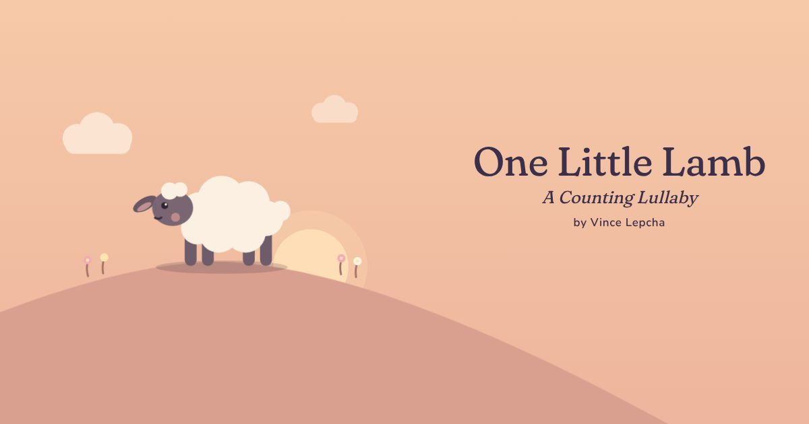
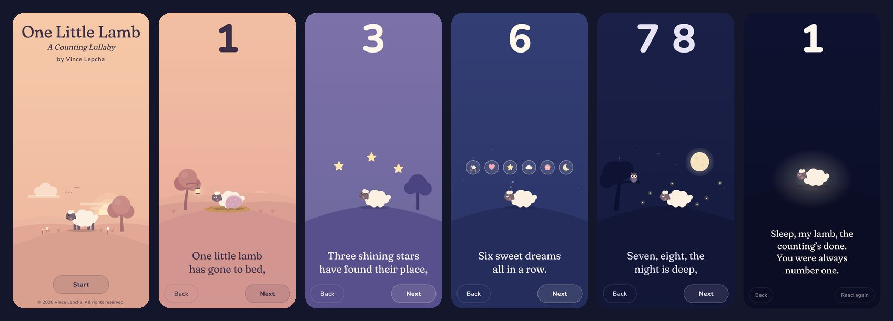

<div align="center">



# One Little Lamb

**A Counting Lullaby by Vince Lepcha**

A ten-screen bedtime picture book for the web. Tap through the lullaby page by page,<br>
counting from one to ten as the sky fades from dusk to night.

[**Read the book →**](https://vincelepcha.github.io/one-little-lamb/)

[](https://vincelepcha.github.io/one-little-lamb/)


</div>

<br>

<p align="center">
  
</p>

## About

*One Little Lamb* is a lullaby written by Vince Lepcha in 2026, made into a picture book to read with a small child at bedtime. Each page holds one line of the lullaby, a big number to count, and a small illustration of that line.

It's built to be shared as a link (it opens fast from WhatsApp) and read in a dim room.

## Features

- **Made for bedtime.** Warm, dim colours that darken a step per page. No bright screens, sounds, flashing or rewards.
- **Counting along.** A big number on every page. Pages one to six show that many things to point at, appearing one at a time.
- **Small hands, safe pace.** Pages turn only with **Next** / **Back**, a deliberate swipe, or the arrow keys. Stray taps do nothing, and quick repeated taps are ignored.
- **Calm motion.** Gentle breathing, swaying and twinkling, all switched off when the device asks for reduced motion.
- **Keeps the screen on** while reading (Screen Wake Lock API), then lets the phone sleep once the book has finished.
- **Installable and offline.** Add it to the home screen with its own icon. After the first visit it opens without a connection.
- **Linkable pages.** Every page has its own address, e.g. [`#page-3`](https://vincelepcha.github.io/one-little-lamb/#page-3).
- **Accessible.** Real labelled buttons, alt text for every picture, high-contrast text and 44 px touch targets.
- **Private.** No analytics, cookies, ads, trackers or third-party requests. Fonts are self-hosted.

## Built with

Plain HTML, CSS and JavaScript, with no framework, no build step and no dependencies, so it should keep working for decades. Every illustration is inline SVG drawn in code, so it stays sharp on any screen and costs almost nothing to download.

```
one-little-lamb/
├── index.html            Pages, words, metadata and shared SVG shapes
├── scenes.js             The illustration for each page (inline SVG)
├── style.css             Sky colours, layout, fades and gentle animation
├── script.js             Page turning, counting reveals, wake lock, offline setup
├── sw.js                 Service worker for offline reading
├── manifest.webmanifest  Home-screen install
├── fonts/                Fraunces and Nunito, subset to the characters used
├── icons/                App icons
├── og-cover.jpg          Link-preview image
└── docs/                 README images
```

## Running locally

There's nothing to install or build. Get the files, then serve the folder with any static web server. Python's built-in one is the quickest:

```bash
git clone https://github.com/vincelepcha/one-little-lamb.git
cd one-little-lamb
python3 -m http.server 8000
```

Then open <http://localhost:8000>. Press <kbd>Ctrl</kbd>+<kbd>C</kbd> to stop the server.

- On Windows, use `python -m http.server 8000` (or `py -m http.server 8000`). Python must be installed.
- Offline reading works on `localhost` too, so you can test it by turning off your connection and reloading.
- Opening `index.html` directly (double-clicking it) shows the book, but offline reading and home-screen install need a server.

## Publishing changes

The site is deployed by GitHub Pages from the root of `main`.

1. Commit and push to `main`. Pages republishes within a few minutes.
2. Bump the cache name in [`sw.js`](sw.js) (`one-little-lamb-v8` → `v9`, and so on). Phones that saved the book then switch to the new version the next time they open it online.

Link previews are cached by WhatsApp and other apps. To see an updated preview straight away, share the link with a query string, e.g. `…/one-little-lamb/?v=2`.

## Credits

- Lullaby by Vince Lepcha.
- [Fraunces](https://github.com/undercasetype/Fraunces) and [Nunito](https://github.com/googlefonts/nunito), both under the SIL Open Font License 1.1.

## Copyright

© 2026 Vince Lepcha. All rights reserved.

This repository is public so the book can be read and shared, but it is **not** open source. The lullaby, illustrations and code may not be copied, republished or adapted without permission.
